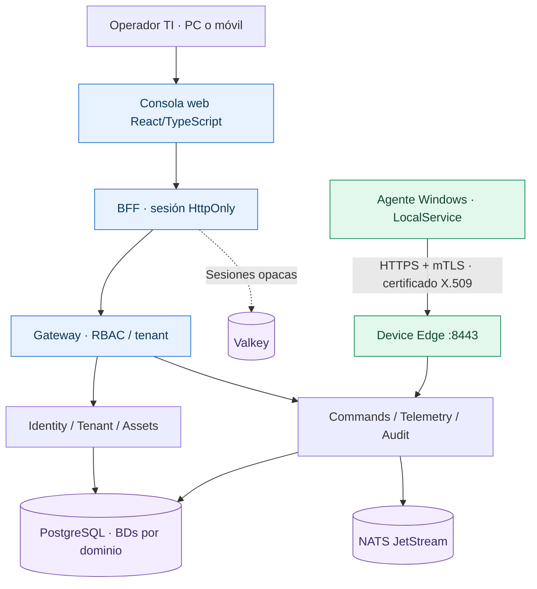
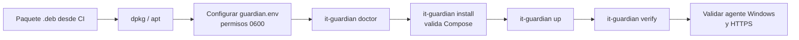

<div align="center">

# 🛡️ IT Guardian
### Plataforma empresarial de administración TI · Self-hosted · Agentes propios

**Equipos · Inventario · Telemetría · Operaciones · Auditoría**

[](ROADMAP.md)
[](docs/P0_DELIVERY_ROADMAP_2026.md)
[](ROADMAP.md)
[](packaging/debian/build.py)

**[Roadmap visual](ROADMAP.md) · [Entrega P0](docs/P0_DELIVERY_ROADMAP_2026.md) · [Seguridad y cumplimiento](docs/security/SOC2_ISO27001_CONTROL_BASELINE.md) · [Arquitectura detallada](MASTER.md)**

</div>

> **Estado comprobable:** v0.8.0 está documentada como certificada por el proyecto. La v0.8.1 corresponde a cambios en PR Draft pendientes de verificar en CI y en equipos físicos. IT Guardian no declara certificación externa SOC 2 ni ISO/IEC 27001.

## Visión general

IT Guardian permite administrar desde una consola central organizaciones, sedes, activos y endpoints. El agente Windows se identifica mediante certificados propios y envía telemetría hacia un servidor autohospedado. La arquitectura separa estrictamente el plano administrativo del plano de dispositivos.

### Arquitectura visual del sistema



> El navegador **nunca** accede directamente al Device Edge ni recibe los tokens privados de Identity. Los agentes se conectan al borde mTLS; no es necesario abrir puertos de entrada hacia cada computadora.

### Camino hacia Enterprise Stable

```mermaid
flowchart LR
    A["v0.8 · Core y consola<br/>Documentado DONE"] --> B["P0 · v0.8.1–0.8.2<br/>Debian, UX, hardening"]
    B --> C["v0.9 · Software / Patch / Policy"]
    C --> D["v0.10–0.11<br/>Tickets / Remoto propio"]
    D --> E["v0.12–0.19<br/>Seguridad / Agentes / Infra"]
    E --> F["v0.20 RC<br/>Pruebas integrales"]
    F --> G["v1.0<br/>Enterprise Stable"]
    classDef done fill:#e4f8ee,stroke:#19845e,color:#15513b
    classDef current fill:#fff3d9,stroke:#bd8120,color:#694715
    classDef planned fill:#eaf1fa,stroke:#6789ae,color:#294663
    class A done
    class B current
    class C,D,E,F,G planned
```



## Entrega P0 — guía de estado

| Área | Lo existente en v0.8 | Cambio propuesto en PR P0 | Cierre exigido |
|---|---|---|---|
| Consola | React, RBAC, BFF, inventario | Responsive, navegación móvil, acabado visual | Build + pruebas accesibilidad + Playwright |
| Debian | Arranque Docker Compose manual | Constructor `.deb` + CLI `it-guardian` | Instalación en Debian limpio + rollback probado |
| Seguridad | PKI, mTLS, auditoría, permisos | Baseline ISO 27001/SOC 2 y controles de instalador | Evidencias técnicas y procedimientos revisados |
| Operaciones | Telemetría + comandos tipados | Diagnóstico y gestión Compose por CLI | MSI Windows físico + E2E en servidor |
| Recuperación | Servicios persistentes | Plan de backup/restauración | **Pendiente**: PostgreSQL restore real |

**El README muestra entregables y gates, no porcentajes inventados ni funciones ficticias.** Consulta el [roadmap detallado](ROADMAP.md) para todos los módulos.

## Instalación Debian — v0.8.1 experimental



El empaquetador está en `packaging/debian/build.py` y el CLI en `packaging/debian/it_guardian_cli.py`. Requiere Docker Engine/Compose v2 instalado, configuración de secretos y `root` para las operaciones del host.

```bash
# Compilar .deb desde un checkout completo en Debian/Ubuntu:
python3 packaging/debian/build.py --output-dir artifacts

# Instalar paquete generado (solo tras validarlo):
sudo apt install ./artifacts/it-guardian_0.8.1_all.deb
# Preparar /etc/it-guardian/guardian.env con secretos únicos y modo 0600.
sudo it-guardian doctor
sudo it-guardian install
sudo it-guardian up
sudo it-guardian status
sudo it-guardian verify
```

⚠️ `backup-config` **solo conserva configuración**; todavía no implementa recuperación PostgreSQL. El paquete `0.8.1` no se considera listo para producción hasta pasar los gates de instalación, restore, HTTPS y agente físico.

## Pantallas disponibles y siguientes

| Consola actual (v0.8) | Próxima evolución |
|---|---|
| Overview y KPIs | Alertas operativas y reportes |
| Empresas y sedes | Políticas y segmentación avanzadas |
| Activos / dispositivos | Catálogo de software y parches |
| Comandos tipados / Enrollment | Acciones por política, instaladores de agente |
| Auditoría / usuarios | Evidencia de cumplimiento y accesos |
| — | Tickets, soporte remoto propio, backup, MDM |

---

<details>
<summary><strong>Documentación técnica original del core v0.8 (expandir)</strong></summary>


Sistema Central de Administración Empresarial de TI, self-hosted y modular.

IT Guardian se construye por capacidades utilizables de punta a punta. Un módulo solo se marca terminado cuando existe runtime real, seguridad, integración, packaging cuando aplica, clean-stack reproducible y CI verde sobre el mismo SHA candidato.

## Estado del proyecto

**Release actual:** `0.8.0`  
**Core certificado:** Identity + Tenant + Asset + Enrollment + PKI + Gateway + Audit + Agent Control + Command + Telemetry + Device Edge + Windows Agent Modern + Web Console MVP  
**Siguiente gate:** `v0.9.0 — Software + Patch + Policy`  
**Enterprise Stable:** todavía NO; `v1.0.0` requiere cerrar los módulos posteriores del roadmap.

### Matriz de avance

| Componente | Estado | Release | Evidencia principal |
|---|---|---:|---|
| Identity Service | ✅ DONE | 0.1.0 | Argon2, JWT Ed25519/JWKS, RBAC |
| Tenant Service | ✅ DONE | 0.2.0 | tenants, sedes, departamentos, membresías |
| Asset Service | ✅ DONE | 0.3.0 | inventario canónico y correlación externa |
| Enrollment + PKI | ✅ DONE | 0.4.0 | token one-time, CSR, certificados, CRL |
| Gateway + Audit | ✅ DONE | 0.5.0 | borde administrativo y audit hash-chain |
| Agent Control + Command + Telemetry | ✅ DONE | 0.6.0 | online/offline, jobs tipados, telemetry |
| Device Edge mTLS | ✅ DONE | 0.7.0 | X.509/SPIFFE, CRL, allowlist, non-root |
| Windows Agent Modern | ✅ DONE | 0.7.0 | DPAPI, mTLS, telemetry, commands, spool, updater, MSI |
| Web Console MVP | ✅ DONE | 0.8.0 | BFF seguro, RBAC, tenant/sede, Chromium E2E |
| Software + Patch + Policy | 🟡 SIGUIENTE | 0.9.0 | RMM básico |
| Tickets + Help Client | ⬜ PENDIENTE | 0.10.0 | ITSM inicial |
| Remote Support | ⬜ PENDIENTE | 0.11.0 | soporte remoto |
| Security + Wazuh + USB | ⬜ PENDIENTE | 0.12.0 | postura/endpoint security |
| Linux + macOS Agents | ⬜ PENDIENTE | 0.13.0 | agentes modernos multiplataforma |
| Servers + Zabbix + Printers | ⬜ PENDIENTE | 0.14.0 | infraestructura |
| Backup | ⬜ PENDIENTE | 0.15.0 | backup/restore |
| Network + Wi-Fi + VPN | ⬜ PENDIENTE | 0.16.0 | networking |
| Android/iOS MDM + Location | ⬜ PENDIENTE | 0.17.0 | movilidad |
| DFIR + Vulnerability | ⬜ PENDIENTE | 0.18.0 | respuesta/vulnerabilidades |
| Automation + Reports + Licensing | ⬜ PENDIENTE | 0.19.0 | automatización empresarial |
| RC integral | ⬜ PENDIENTE | 0.20.0-rc | hardening integral |
| Enterprise Stable | ⬜ PENDIENTE | 1.0.0 | producto empresarial completo |

## Arquitectura operativa v0.8

```text
                         ADMIN PLANE
Browser
   |
   v
Web Console + BFF :8088 ----> Valkey interno (sesiones opacas)
   |
   v
Gateway :8080
   |
   +---- Identity :8001
   +---- Tenant   :8002
   +---- Asset    :8003
   +---- PKI      :8004
   +---- Enrollment :8005
   +---- Audit    :8006
   +---- Agent Control :8007 (solo admin routes northbound)
   +---- Command       :8008 (solo admin routes northbound)
   +---- Telemetry     :8009 (solo admin routes northbound)

                         DEVICE PLANE
Windows Agent Modern
   |
   | HTTPS + mTLS / X.509 SPIFFE
   v
Device Edge :8443
   +----> Agent Control
   +----> Command
   +----> Telemetry
```

El Gateway no expone `/api/v1/device/*`. Device Edge es el único borde del plano endpoint y deriva `tenant_id`, `guardian_asset_id`, `device_id` y serial del certificado X.509 validado. El Web Console BFF usa una allowlist administrativa y el navegador nunca recibe bearer tokens de Identity.

## Web Console v0.8

La consola implementa:

- login/logout real mediante el BFF y Gateway;
- Overview;
- selector de empresa y sede mantenido solo en memoria;
- Organización;
- Activos;
- Dispositivos y detalle;
- online/offline y telemetry básica;
- comandos allowlisted y seguimiento de estado;
- Enrollment/tokens;
- visor y verificación de Audit;
- Usuarios;
- navegación y URLs protegidas por RBAC;
- estados loading/empty/error.

### Seguridad de sesión

- cookie opaca `HttpOnly`, `SameSite=Strict` y `Secure` en producción;
- tokens Identity permanecen server-side;
- Valkey/Redis de sesiones es interno a Compose;
- CSRF para mutaciones;
- CSP y headers de hardening;
- `Cache-Control: no-store` en BFF API;
- ningún token/scope se persiste en `localStorage` o `sessionStorage`;
- no existe acceso Web Console al device plane.

## Certificación v0.8.0

`.github/workflows/web-console-ci.yml` certifica sobre el mismo SHA:

- tests frontend (incluido scope tenant/sede y RBAC);
- TypeScript + Vite production build;
- escaneo que rechaza persistencia de tokens en navegador;
- tests/compile del BFF;
- boundary BFF fijo;
- tests de Gateway admin y prueba de que device plane no es northbound;
- Agent Control admin API;
- imagen Web Console non-root;
- modelo Compose válido y Valkey sin exposición externa;
- clean-stack desde volúmenes vacíos;
- bootstrap/tenant/sede/activo/enrollment reales;
- certificado de dispositivo y Device Edge mTLS real;
- heartbeat `ONLINE` y telemetry;
- login y selección de scope desde Chromium;
- comando creado desde UI, adquirido por agente mTLS y terminado `SUCCEEDED`;
- aparición del lifecycle en Audit;
- logout y eliminación de cookie;
- aislamiento runtime.

Los gates v0.6/v0.7 continúan siendo la evidencia de regresión del core endpoint/Windows Agent y Device Edge.

## Servidor — instalación

### Requisitos

- Linux recomendado para producción;
- Windows con Docker Desktop/WSL2 o macOS con Docker Desktop para instalaciones compatibles/laboratorio;
- Docker Engine + Compose v2;
- puertos administrativos locales configurables `8001–8009`, `8080`, `8088`, `8443` y monitor NATS `8222`.

### Arranque

```bash
cp .env.example .env
```

Defina como mínimo `POSTGRES_PASSWORD`, `IDENTITY_SIGNING_KEY`, `ENROLLMENT_SIGNING_KEY`, `DEVICE_PROXY_SHARED_SECRET` y `VALKEY_PASSWORD` con valores aleatorios fuertes.

```bash
docker compose config
docker compose up -d --build
docker compose ps
```

Readiness HTTP del servidor/BFF:

```bash
for p in 8001 8002 8003 8004 8005 8006 8007 8008 8009 8080 8088; do curl -fsS http://127.0.0.1:$p/health/ready; done
```

Abra la Web Console en:

```text
http://<servidor>:8088/console/
```

En producción publique `8088` detrás de HTTPS/reverse proxy y mantenga `WEB_CONSOLE_COOKIE_SECURE=true`. Device Edge `:8443` requiere certificado cliente mTLS y no debe tratarse como endpoint anónimo.

## Windows Agent Modern v0.7

El agente Windows certificado se mantiene como device runtime de v0.8. Soporta Windows 10/11 moderno, servicio `ITGuardianAgent` bajo `LocalService`, ECDSA P-256, DPAPI LocalMachine, mTLS, CPU/RAM/discos, spool offline y updater Ed25519 con rollback.

Comandos permitidos:

- `inventory.refresh`;
- `device.reboot`;
- `service.restart`.

No existe `shell.exec`, PowerShell remoto ni command prompt arbitrario.

## Seguridad de claves

- Identity y Enrollment usan signers privados separados.
- Root PKI no está disponible al runtime API.
- Device Edge no monta la CA privada de su TLS de servidor.
- El principal endpoint deriva del certificado, nunca de headers elegidos por cliente.
- Private keys de dispositivo permanecen en el endpoint y Windows usa DPAPI LocalMachine.
- El updater acepta únicamente catálogo/clave Ed25519 pinneados en configuración.
- Web Console mantiene tokens administrativos fuera del navegador.

## Gate Core MVP

- [x] levantar servidor completo;
- [x] crear/autenticar `platform_admin`;
- [x] crear empresa/sede/departamento/activo;
- [x] emitir token, CSR y certificado;
- [x] instalar/desinstalar Windows Agent vía MSI x64;
- [x] establecer identidad mTLS de dispositivo;
- [x] heartbeat y estado ONLINE;
- [x] pipeline CPU/RAM/discos y telemetry;
- [x] ejecutar comandos allowlisted sin shell arbitrario;
- [x] recibir resultado idempotente y auditar lifecycle;
- [x] spool/retry offline;
- [x] update firmado + rollback transaccional;
- [x] administrar visualmente el core desde Web Console v0.8.

El Core MVP visual ya está cerrado; el producto completo sigue avanzando por módulos. El siguiente gate es v0.9 Software + Patch + Policy.

## Compatibilidad legacy

Windows 7/8/8.1, macOS Lion–10.12, KaiOS, Symbian y adaptadores Huawei específicos usan una matriz de capacidades separada. No se afirma paridad donde la plataforma no la permite.

Consulte `ROADMAP.md` para el estado canónico y `MASTER.md` para la arquitectura completa.
\n</details>\n